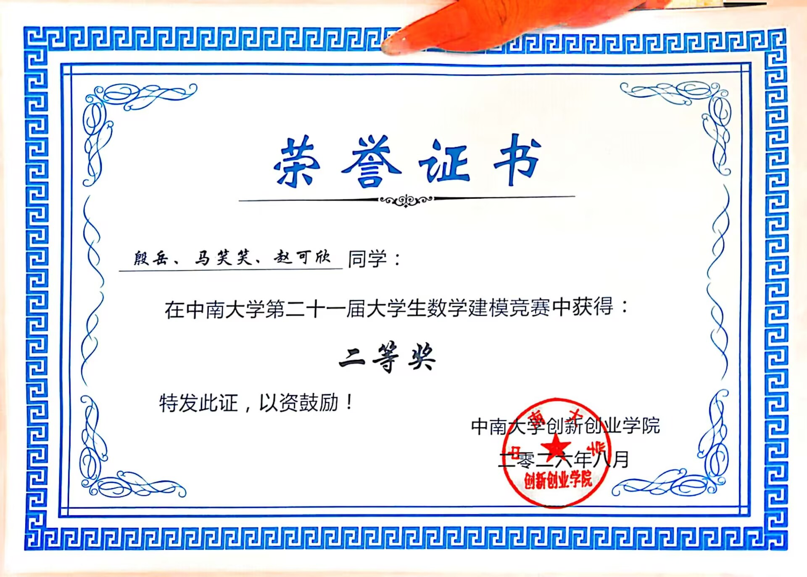

# 机械设备故障检测：多尺度谱估计与鲁棒传感器融合

2026 年 NUDT-CSU 数学建模联赛 A 题参赛论文与完整支撑材料。

- **赛事**：2026 年 NUDT-CSU 数学建模联赛（即中南大学第二十一届大学生数学建模竞赛）
- **赛题**：A 题 · 机械设备故障检测
- **队伍**：无敌暴龙战队（殷岳、马笑笑、赵可欣）
- **学校**：中南大学
- **完成时间**：2026-06-23
- **获奖**：中南大学第二十一届大学生数学建模竞赛 **二等奖**（2026 年 8 月，中南大学创新创业学院颁发）
- **论文**：[参赛论文 PDF](paper/参赛论文—A题：基于多尺度谱估计与鲁棒传感器融合的机械设备故障检测研究—无敌暴龙战队.pdf)

> 说明：论文 PDF 中的参赛学号已做遮盖处理，其余内容保持提交时的原样。

## 获奖

| 项目 | 内容 |
| --- | --- |
| 竞赛 | 中南大学第二十一届大学生数学建模竞赛 |
| 奖项 | 二等奖 |
| 获奖者 | 殷岳、马笑笑、赵可欣 |
| 颁奖单位 | 中南大学创新创业学院 |
| 时间 | 2026 年 8 月 |



## 问题与结论

题目给定 100 Hz 采样、400 s 的振动时序数据，要求在强噪声背景下完成微弱故障检测、波形恢复、多源分离与传感器布局，四个问题逐层递进。

| 问题 | 方法 | 主要结果 |
| --- | --- | --- |
| Q1 单源弱故障检测 | 全段 FFT 与 Welch 分段平均谱双向互补校验，最大谱线检验 + Bonferroni 控制全频段虚警 | 故障特征频率 **2.0000 Hz** |
| Q2 波形恢复 | 三角恒等变换把正弦参数搜索化为正交基线性最小二乘，残差重采样做重复性检验 | 振幅 **0.0352**，初相 **1.574 rad**，残差 RMS **0.1000**，归一化误差中位数 **4.47%** |
| Q3 多源分离 | 候选频率筛选 → BIC 自动定阶 → 多频联合最小二乘拆解 | 源数 **4**，分量 **4.0000 / 7.9999 / 13.0001 / 14.0000 Hz**；可稳定区分间距 **0.005 Hz** 的邻近频率 |
| Q4 传感器布局 | 距离衰减传播模型 + 非相干能量融合，Neyman–Pearson 固定系统虚警率，max-min 最差源检测概率为目标 | 三点分散布设（0.75, 0.5）、（2.0, 1.0）、（3.25, 1.5）；0.9 检测概率所需时长由单传感器 **220.7 s** 降至 **64.4 s**，蒙特卡洛校验实际虚警率与预设 **0.01** 一致 |

## 目录结构

```text
.
├── paper/
│   ├── 参赛论文—A题：…—无敌暴龙战队.pdf      # 41 页正式论文（首页为承诺书）
│   └── latex/                                # LaTeX 源文件、cls 模板与全部插图
├── award/
│   └── 数学建模竞赛获奖证书.jpg               # 校赛二等奖证书
├── code/
│   ├── final_analysis.py                     # 问题一至问题四的统一实现
│   ├── requirements.txt
│   └── README.md
├── data/
│   ├── A题：机械设备故障检测.pdf              # 赛题原文
│   └── data.xlsx                             # 题目附件数据
└── support/
    ├── AI工具详情.pdf                         # 竞赛要求的 AI 使用说明
    └── generated/
        ├── results.json                      # 关键结果汇总
        ├── figures/                          # 图 1—12
        └── tables/                           # Q1—Q4 结果表
```

## 复现

```bash
python -m pip install -r code/requirements.txt
mkdir -p "A题：机械设备故障检测"
cp data/data.xlsx "A题：机械设备故障检测/data.xlsx"
python code/final_analysis.py
```

脚本会在 `generated/` 下重新生成 `results.json`、全部结果表和论文图 1—12。随机种子固定为 `20260622`，结果可复现；运行环境为 Windows 11 + Python 3.13。

## 说明

- 本仓库仅包含竞赛提交件与支撑材料，不含其他项目的代码或数据。
- 论文使用 LaTeX（`cumcmthesis.cls`）排版，`paper/latex/论文.tex` 为完整源码，编译中间文件（`.aux`、`.log`、`.synctex.gz`）已剔除。
- 赛题与数据版权归竞赛主办方所有，此处仅作存档与复现用途。
